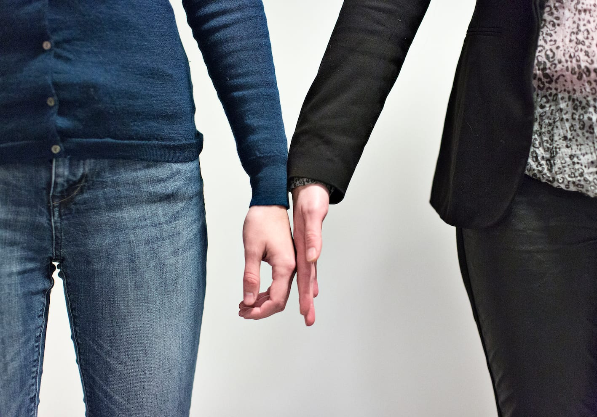
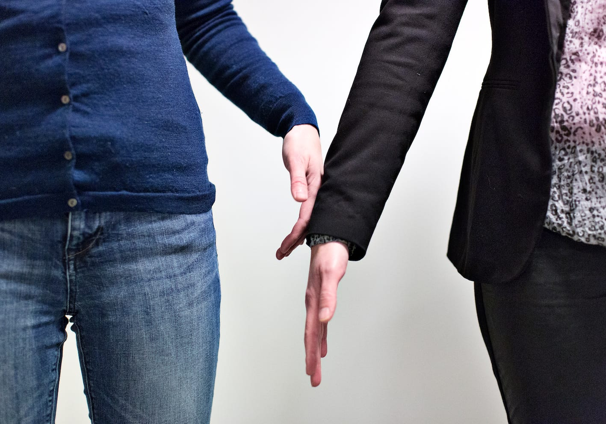
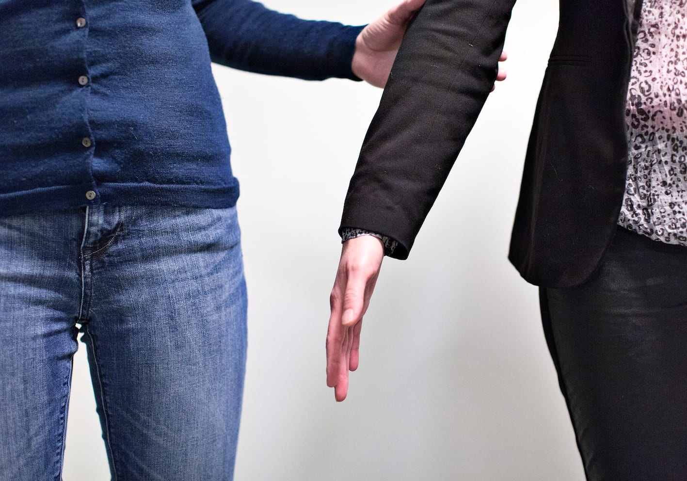
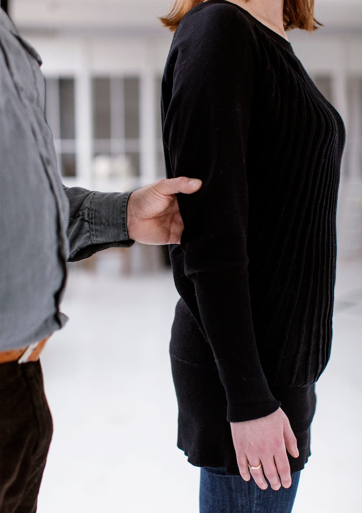
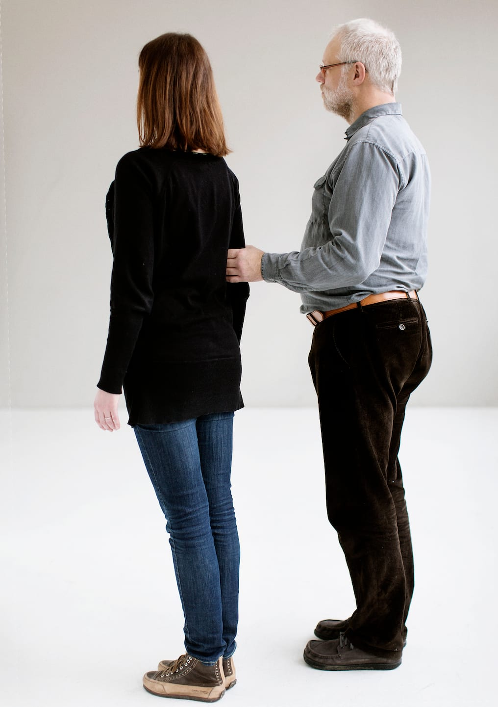
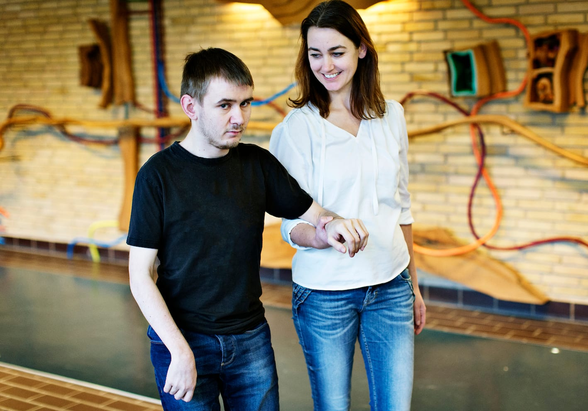
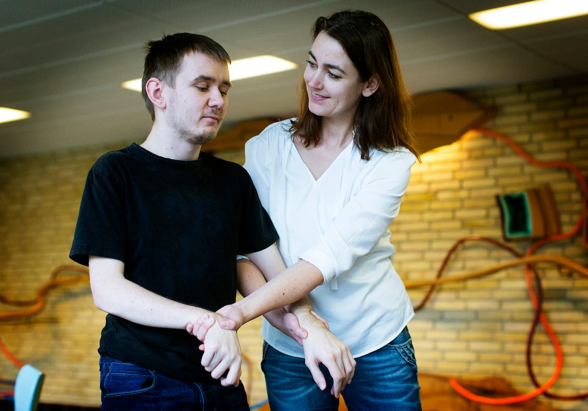

# Sådan holder man fast i hinanden

Det er personen med blindhed, der holder fast i ledsageren, ikke omvendt.

Ledsageren viser, hvor hun er ved at lægge sin håndryg mod Lykkes håndryg. Lykke kan da følge ledsagerens arm og gribe fat i den over albuen.

Bo viser her, hvordan han har fat i ledsagerens arm over albuen med et ”gaffelgreb”. Dvs. med tommelfingeren på ydersiden af ledsagerens arm og de fire andre fingre ind mod ledsagerens krop. Håndleddet skal være strakt.

Den arm, som Bo har fat i, kaldes her i teksten ”ledsagearmen”. Hånden som Bo har fat med kaldes ”ledsagehånden”.

Ledsagearmen kan være strakt eller bøjet, men begge parter skal holde armen tæt ind til kroppen. Så mærkes bevægelserne bedre.

Det vigtigste er at ledsageren går lidt foran Bo, så hun kan fungere som ”skjold”.

På den måde kan ledsageren bedst signalere med bevægelser og ord, hvad der skal foregå.

Det gør det samtidigt muligt for Bo at tage aktivt del i ledsagningen, fx regulere tempoet, lukke døre og selv afgøre, hvornår ledsagningen skal afsluttes.

Ledsageren skal så vidt muligt gå i lige linjer og rette vinkler – det letter orienteringen for Bo, og ledsageren skal være opmærksom på, at man fylder for to.

## Ekstra støtte

Hvis man er dårligt gående eller usikker, kan man, som Marc viser, lade ledsageren give ekstra støtte ved at bruge det støttende greb. Ledsageren tager Marc under armen og holder fast i hans hånd, hvis armlængden tillader det - ellers rundt om hans håndled eller arm.

Samtidig med støttegrebet kan ledsageren evt. række tværs over og tage fat i Marcs frie hånd med sin egen frie hånd.

