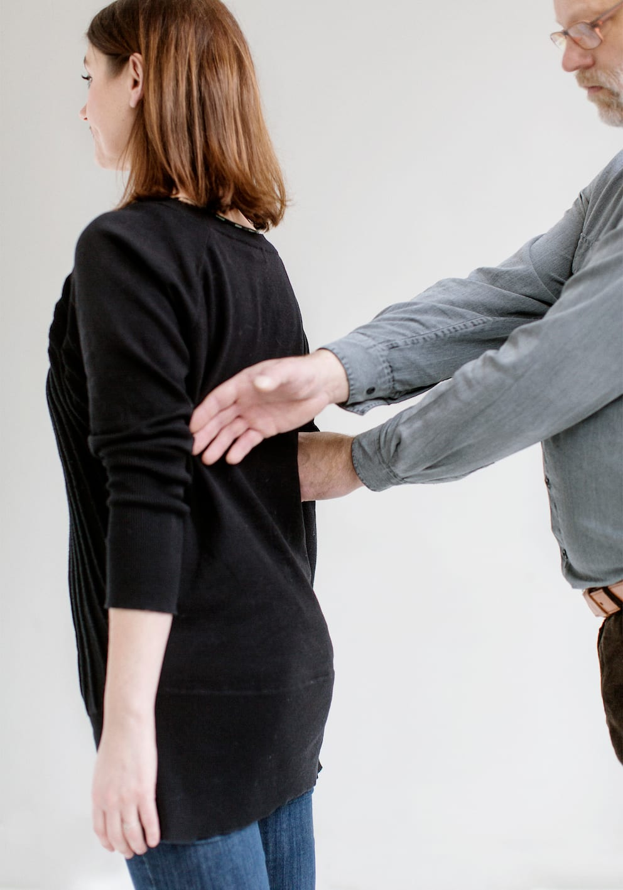

# Sådan skifter man side

I nogle situationer kan det være hensigtsmæssigt, at personen med blindhed skifter side for at holde i ledsagerens anden arm. Det kan fx være, når man skal gennem en dør, for at få fat i et trappegelænder, på befærdede steder, eller hvis man bærer på noget tungt.

Begge parter kan foreslå et sideskift. Sideskiftet kan foretages, enten mens man går, eller når man står stille. Det er vigtigt, at personen med blindhed ikke slipper kontakten til ledsageren.

Når der skal skiftes side lader Bo sin frie hånd krydse hen over ledsagerens ryg og griber fat i den modsatte arm, inden han slipper grebet i den arm, han først havde fat i.

Herefter fortsætter parret som før. Bortset fra at de nu har byttet plads.

Af hensyn til Bos orientering og retningsfornemmelse er det vigtigt, at ledsageren ikke drejer overkroppen, men holder retningen.

Af hensyn til orienteringen er det også Bo, der skifter side bag ryggen af ledsageren, mens ledsageren bliver stående på samme sted.
