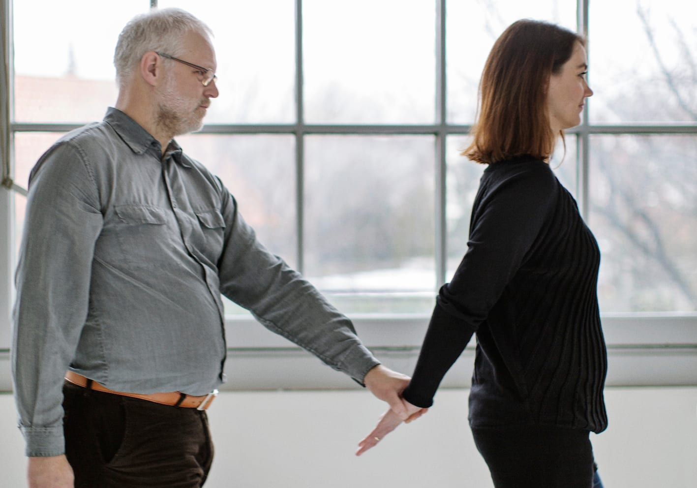
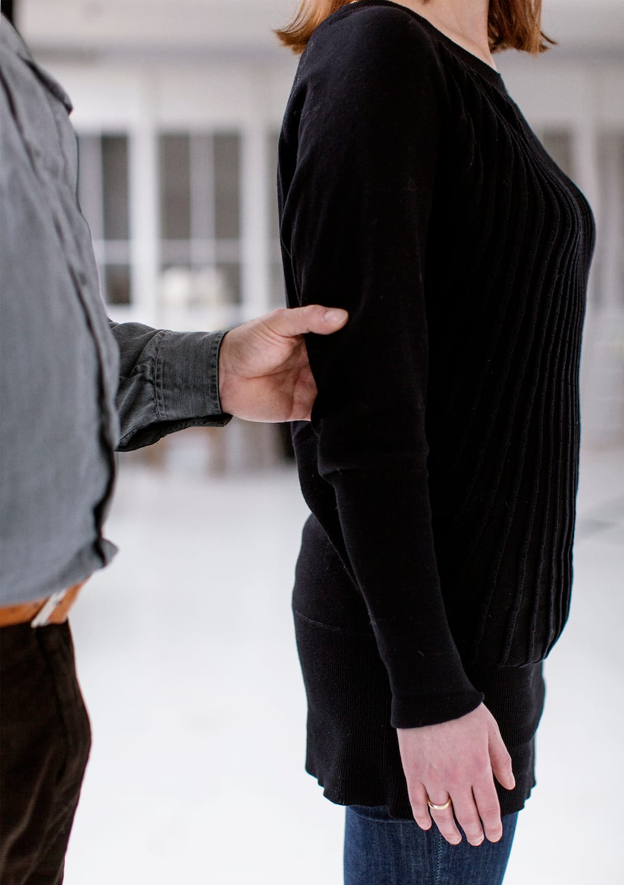
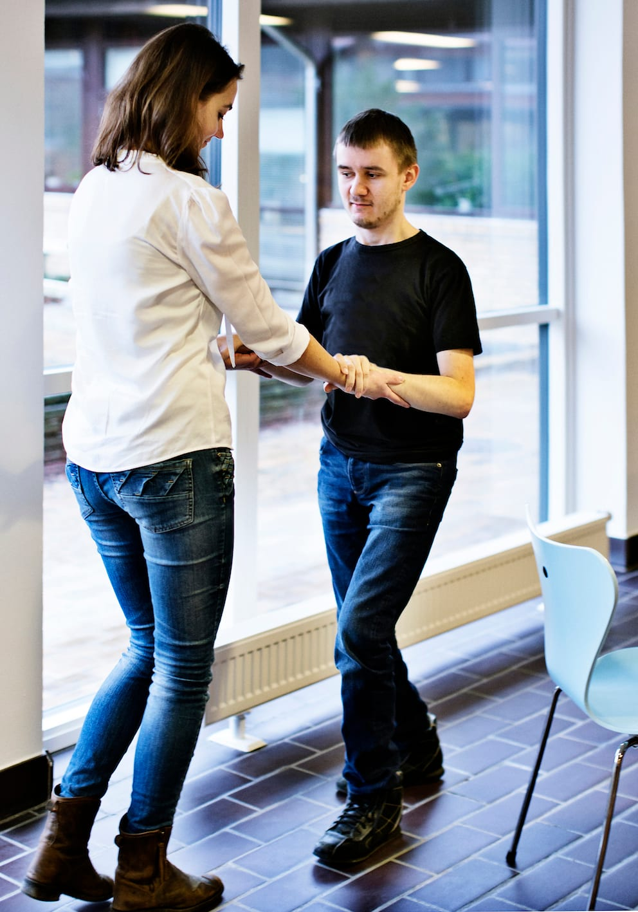

# Sådan passerer man et smalt sted

Ved at føre sin strakte ledsagearm om bag ryggen kan ledsageren markere, at der er smal passage. På den måde viser hun Bo ind bag sig, så han går "i gåsegang". Samtidigt kan hun fortælle Bo, at de nu skal gennem et sted, hvor der er smal passage.

Bo træder ind bag ledsageren og strækker armen for ikke at træde hende i hælene. Bo kan evt. flytte ledsagehånden ned og gribe om ledsagerens håndled for at give endnu mere afstand.

Bo kan sikre sig, at han går lige bagved ledsageren ved kort at lægge sin frie hånd på ydersiden af ledsagerens skulder.

!Foto_1305[Foto af Bo som tjekker sin placering med sin frie hånd]

Det er bedst, hvis ledsageren ikke vender sig om eller drejer kroppen – det kan forvirre Bo. I nogle situationer, fx mellem stolerækker i et teater, kan man vælge at gå sidelæns begge to.

Når det smalle sted er passeret, fører ledsageren sin ledsagearm tilbage til udgangspositionen, og de fortsætter som oprindeligt.

## Ekstra støtte

Hvis der er behov for mere støtte, kan man, som Marc viser, lade ledsageren gå baglæns foran ham og give ekstra støtte ved at holde rundt om begge hans underarme.

