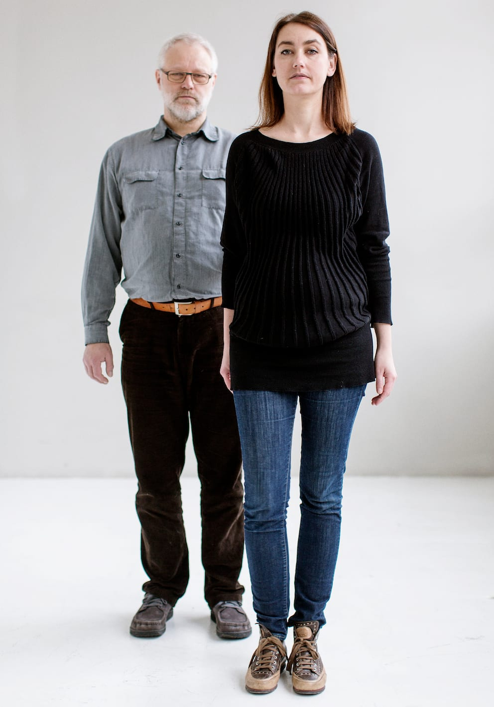
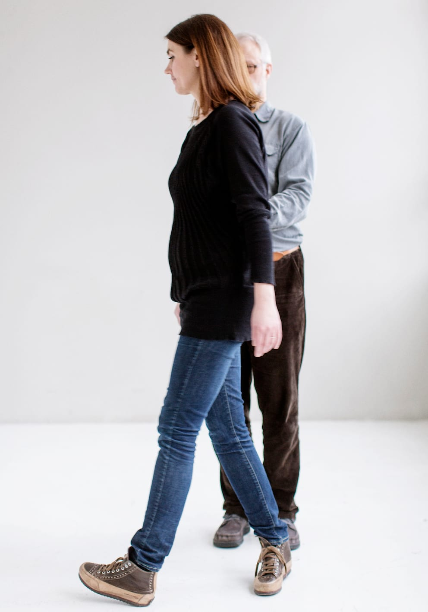
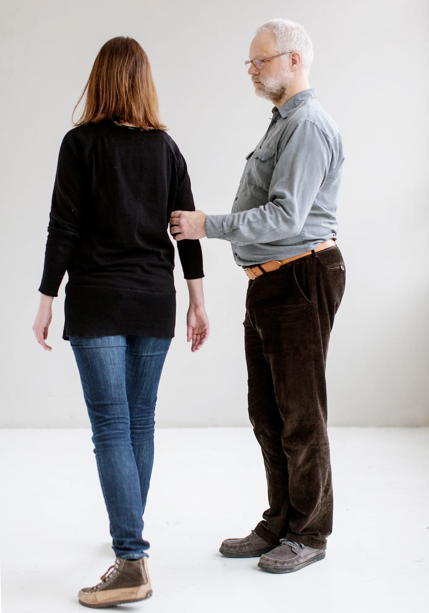
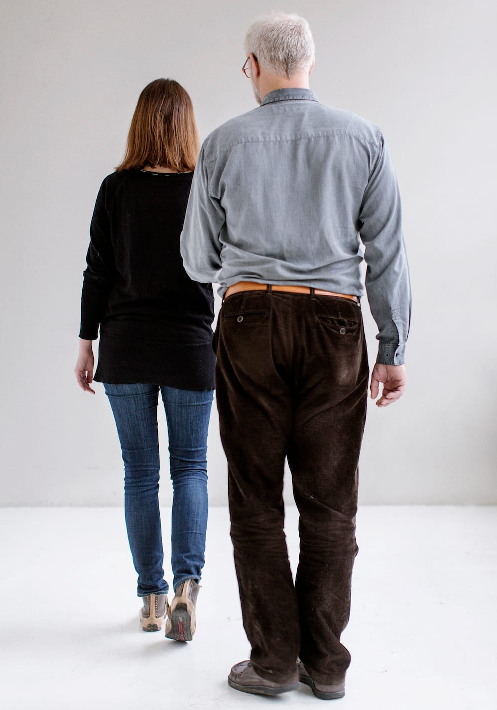
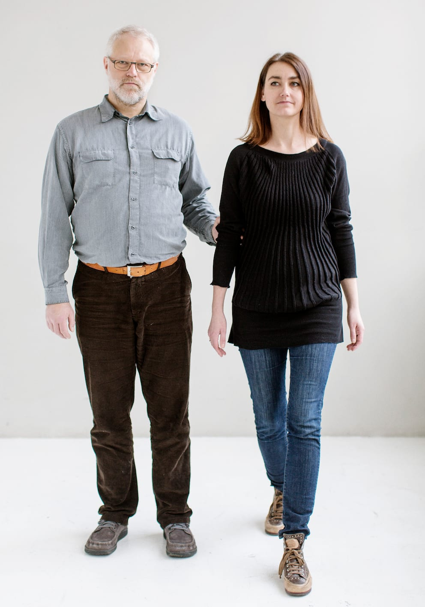
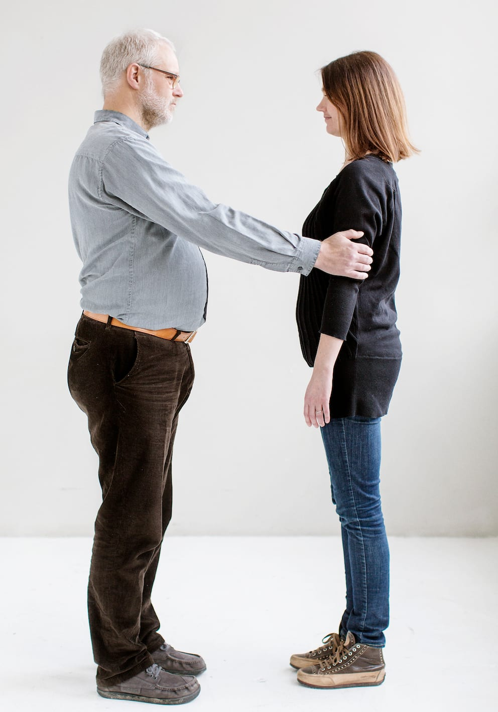
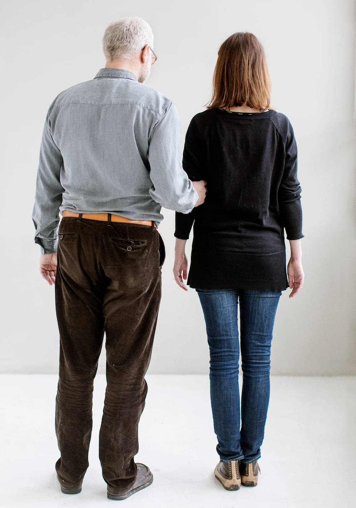

# Sådan skifter man retning

Når man vil vende om og gå i modsatte retning, er det vigtigt, at ledsageren går rundt om Bo. På den måde skal Bo blot dreje på stedet, og parret kan fortsætte i den modsatte retning.

Hvis ledsageren derimod drejer om på stedet, kommer hun til at svinge Bo, rundt som i en karussel, hvilket kan føles ubehageligt og forstyrre orienteringen.

Hvis pladsen er trang, kan man skifte retning ved at stoppe op og vende sig mod hinanden, så man står ansigt til ansigt.

Derefter kan Bo tage fat med sin frie hånd om ledsagerens anden arm og først slippe det oprindelige greb, når det nye greb er etableret.

Herefter drejer parret, så de begge står med ansigtet i den retning de kom fra. Bo har nu skiftet hånd og har fat i ledsagerens anden arm.

Når de begynder at gå igen, genetablerer de positionen, hvor Bo går et halvt skridt bag ledsageren.
