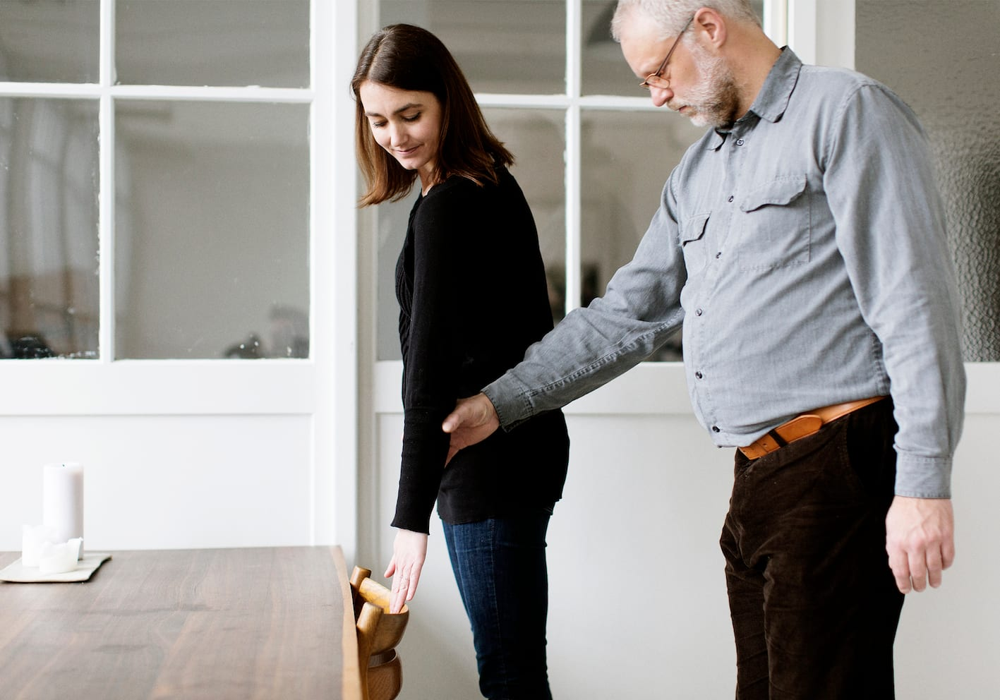
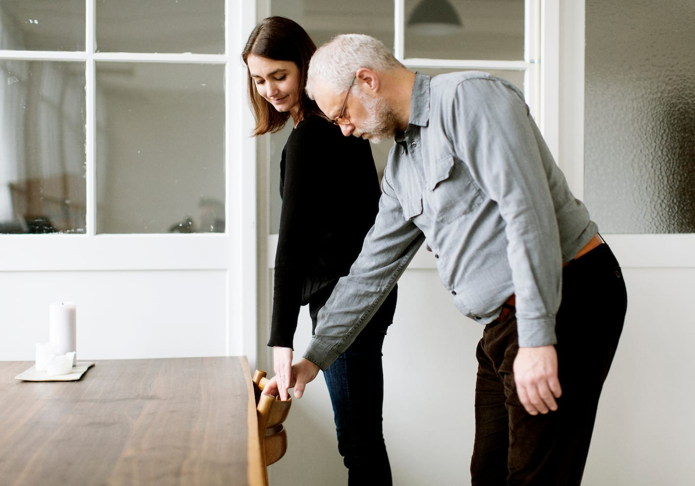
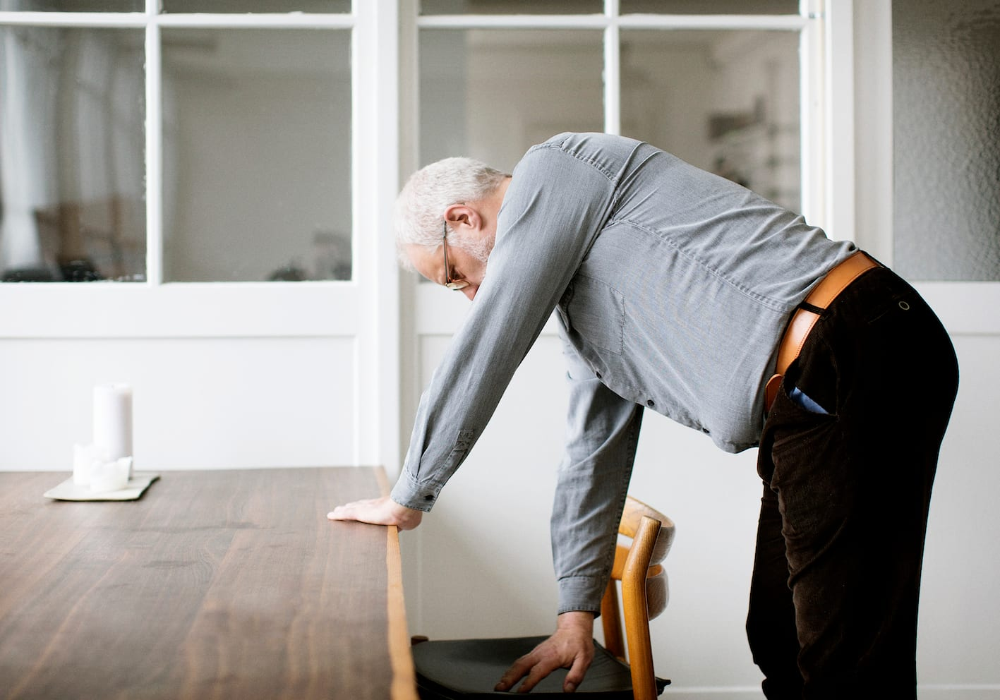
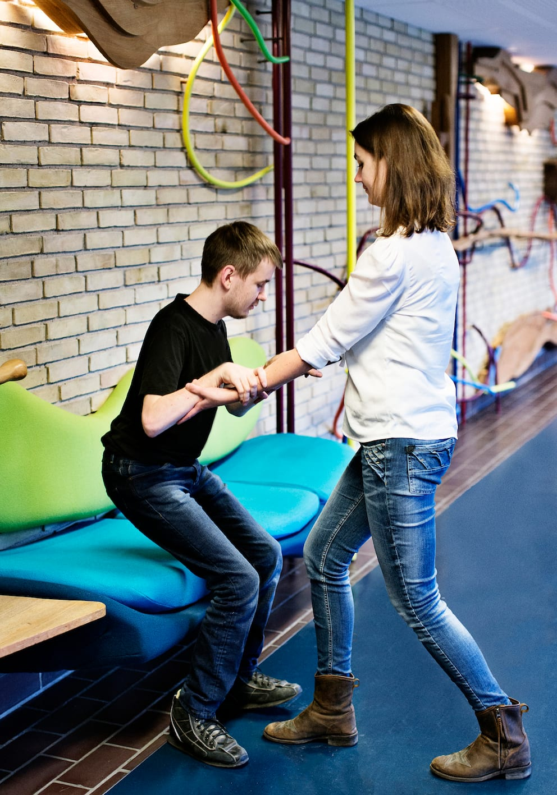

# Siddepladser

Ledsageren viser Bo en stol ved at lægge sin ledsagehånd på stoleryggen bagfra, hvis det er muligt og ellers på armlænet eller sædet.

Så kan Bo følge ledsagerens arm ned til stolen. Ledsageren forklarer, hvordan stolen er placeret i rummet og lader Bo selv klare resten.

Bo skal huske at tjekke med hånden om sædet er tomt, inden han sætter sig.

Ved stolerækker, fx i teatret eller i fly og tog, går begge sidelæns ind med ledsageren forrest. Bo kan da følge stolerækken foran med sin frie hånd.

## Ekstra støtte

Hvis man har brug for ekstra støtte, skal man, som Marc viser, stå foran siddepladsen med ryggen til sædet og have kontakt til møblet med begge knæhaser.

Ledsageren kan stille sig ansigt til ansigt med Marc og holde fast i hans hænder eller overarme for at støtte ham, mens han sætter sig.

Hvis møblet er en stol kan ledsageren evt. stille sig bagved stolen for at sikre, at den ikke rykker sig, mens Marc sætter sig.

Som ekstra sikkerhed kan Marc evt. få et armlæn eller et bord at støtte sig til, mens han sætter sig ned.
