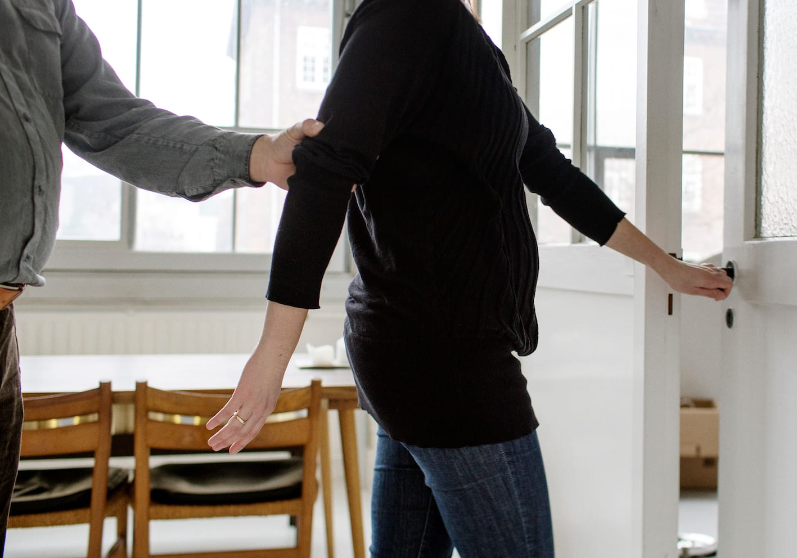
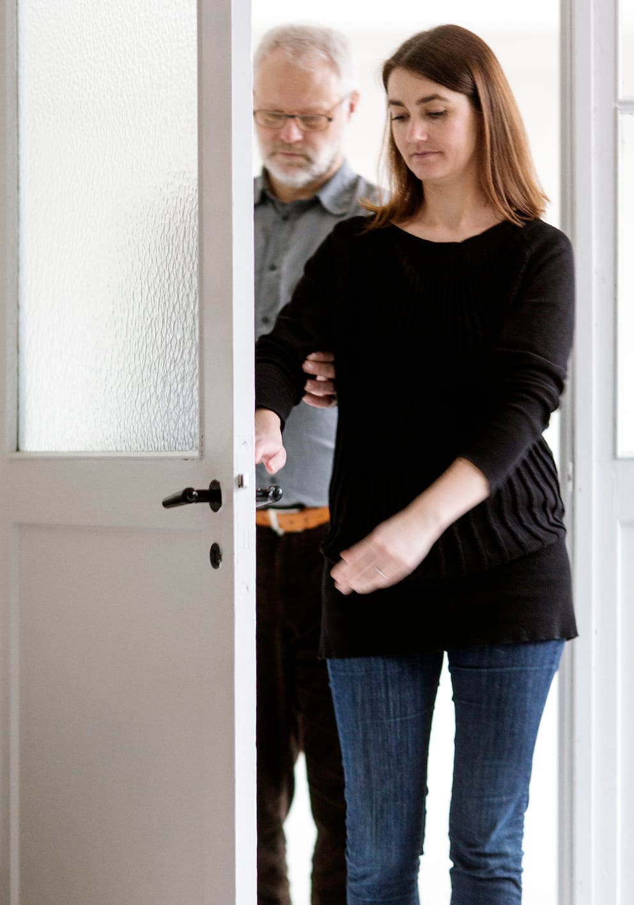
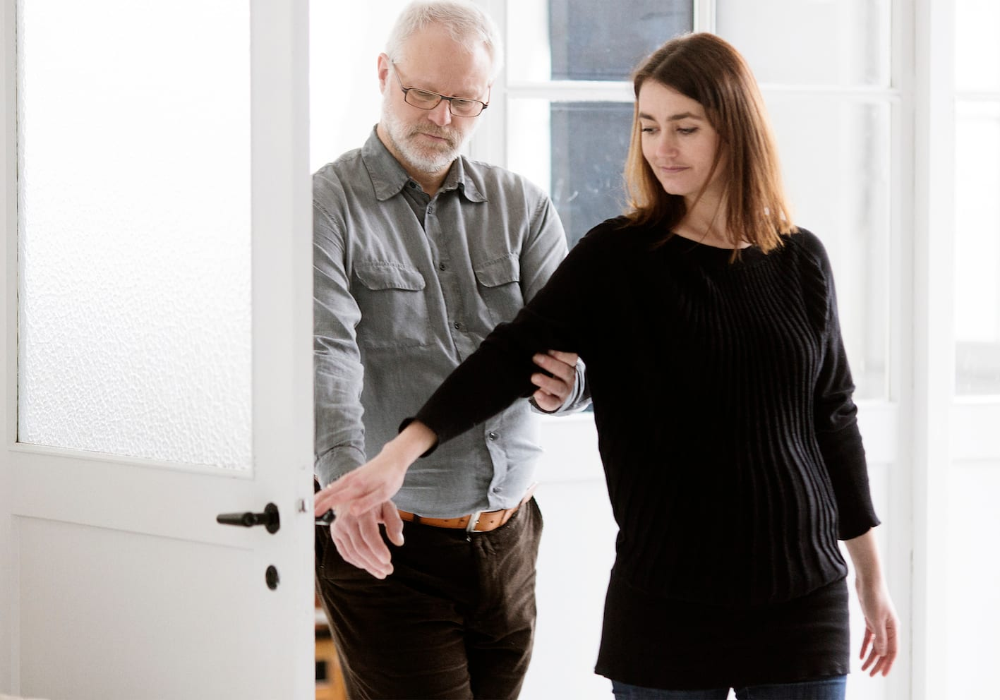
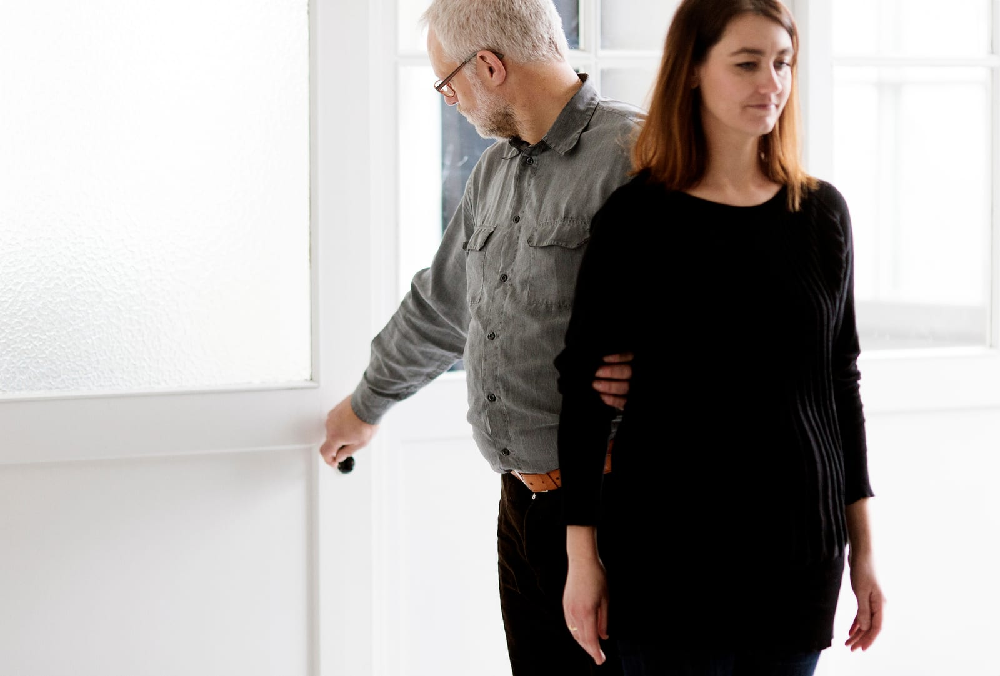
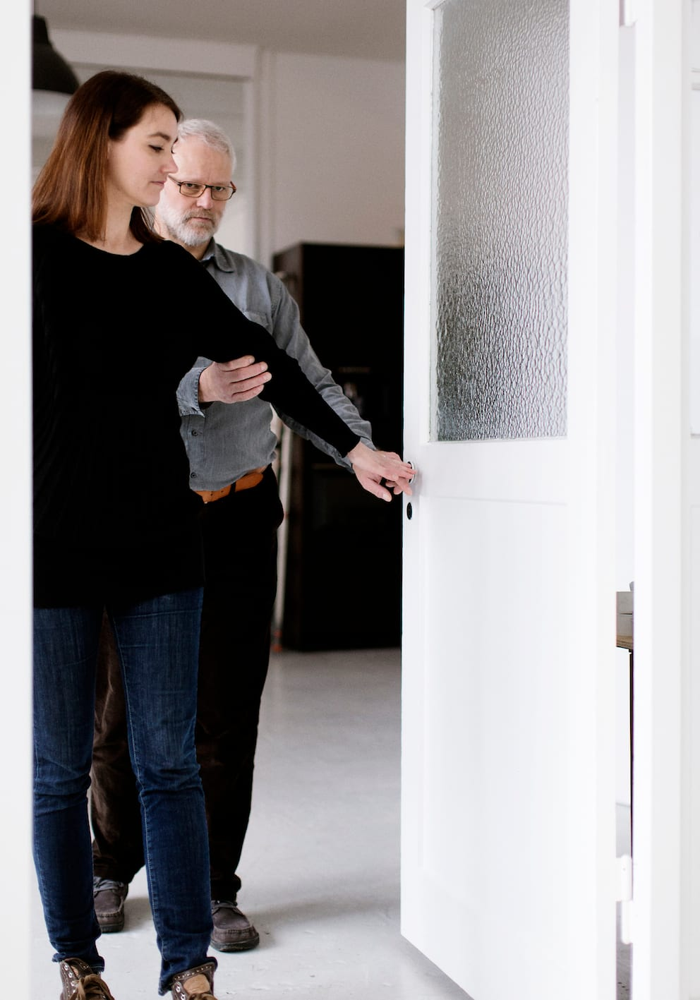
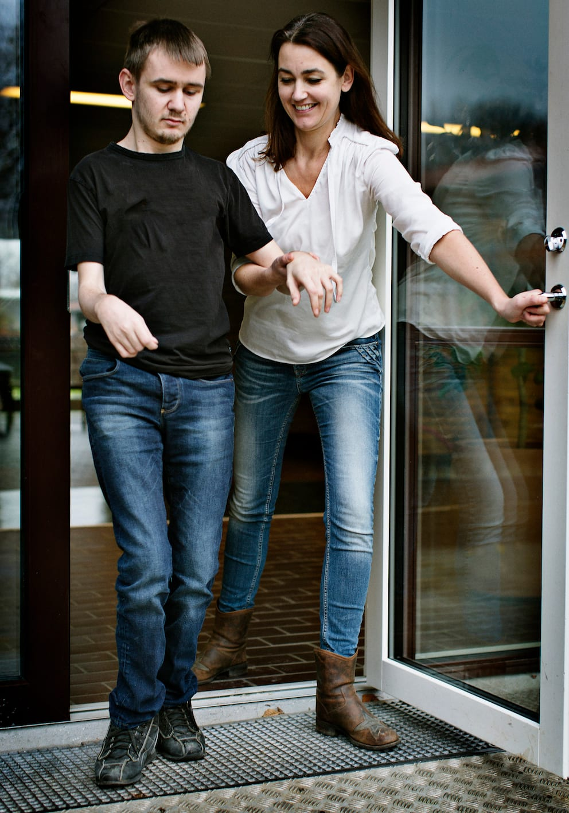

# Døre

Det er nemmest, hvis personen med blindhed befinder sig i den side, hvor dørens hængsler er, så det kan være nødvendigt at skifte side, inden man går gennem døren.

Ledsageren åbner døren med sin frie hånd og lægger derefter sin ledsagehånd på håndtaget.

Bo følger ledsagerens arm ned til håndtaget med sin frie hånd.

Nu går først ledsageren og derefter Bo gennem døren (i gåsegang). Det er Bo, der lukker døren. Det er vigtigt at ledsageren ikke vender sig om, men beholder kroppens position i gangretningen.

Bo må på intet tidspunkt give slip på sin ledsager.

Hvis døren åbner indad placerer ledsageren sin ledsagehånd på det yderste håndtag, når døren er helt åben, hvorefter Bo kan overtage håndtaget og lukke døren, mens han går igennem.

## Ekstra støtte

Ledsageren går baglæns (forrest) og holder Marc i hænderne eller rundt om underarmene, som når man passerer et smalt sted.

Eller ledsageren bevarer støttegrebet og går sidelæns igennem døren. Ledsageren håndterer døren med sin frie hånd. Hvis døråbningen er for smal, går ledsageren baglæns.

