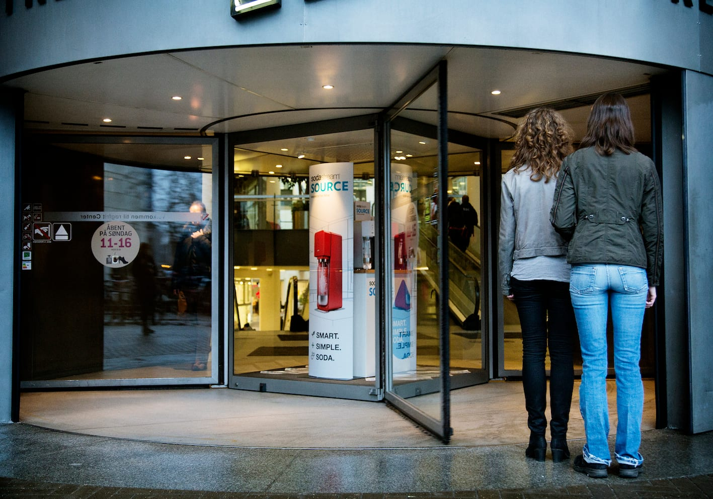
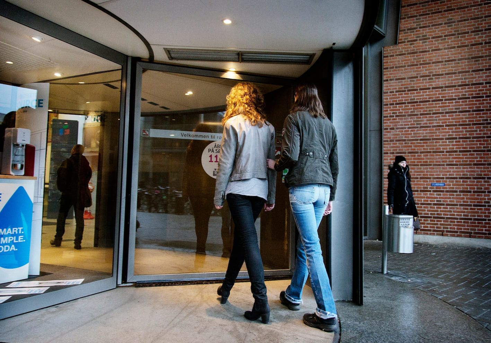
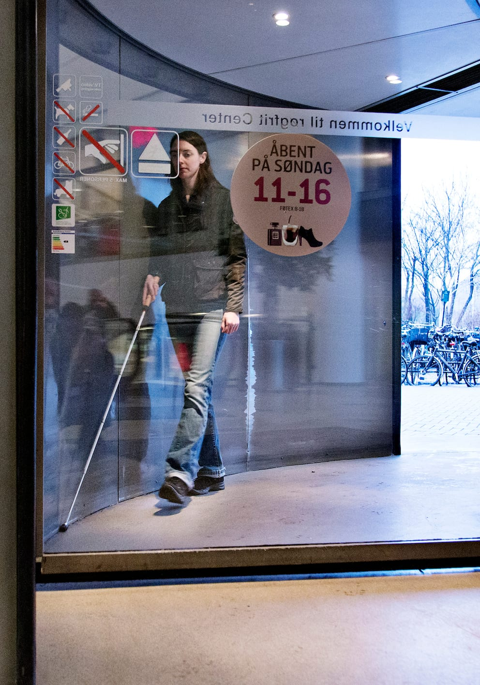

# Svingdøre

Når man kommer til en svingdør, stiller ledsageren sig ved åbningen og fortæller, at man er kommet til en svingdør. Det kan være en god idé også at fortælle lidt om, hvordan svingdøren er bygget op, og hvordan pladsforholdene er.

Hvis der, som her, er plads til både Lykke og ledsageren i én sektion, kan de fortsætte med almindelig ledsageteknik evt. som ved smal passage. Lykke går til højre for ledsageren mens svingdøren passeres.

Hvis der ikke er plads til begge, er det nødvendigt at bryde kontakten, og Lykke går ind i svingdøren på egen hånd enten foran eller bagefter ledsageren.

Inde i svingdøren følger Lykke væggen med højre albue eller håndryg, mens hun går rundt. Når kontakten med væggen ophører, kan hun forlade svingdøren.

