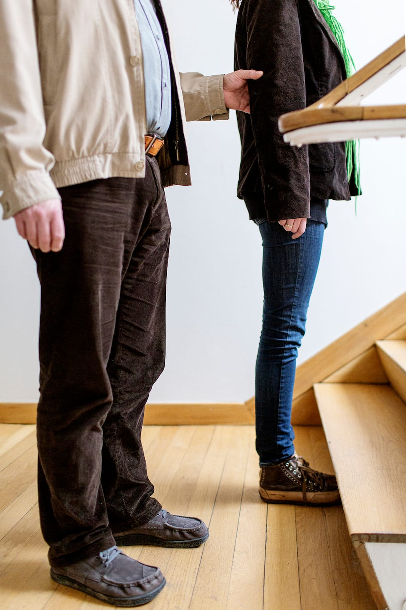
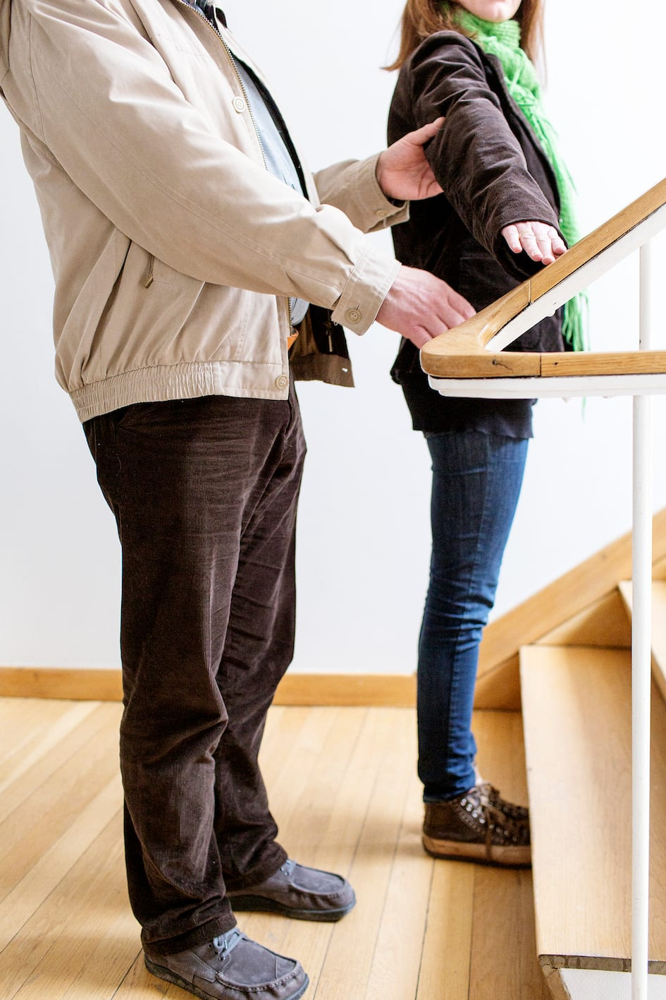
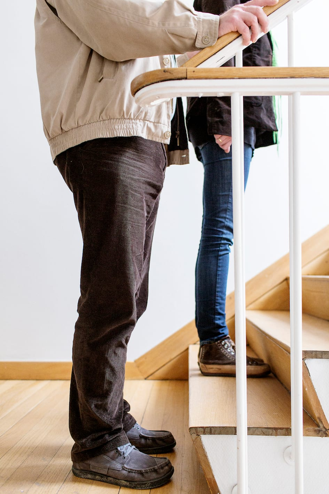
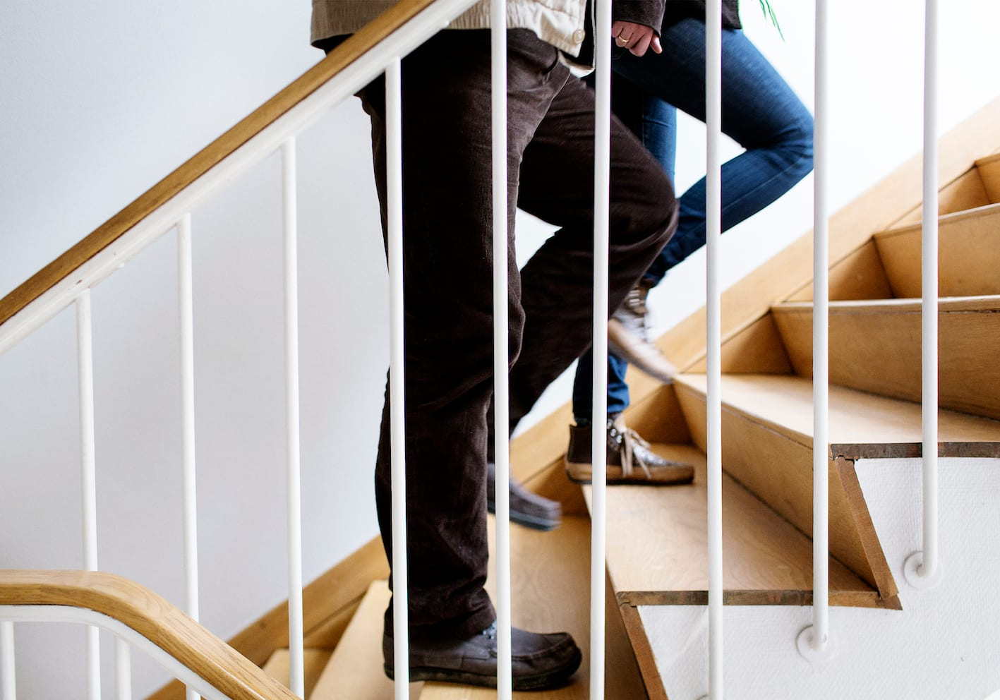
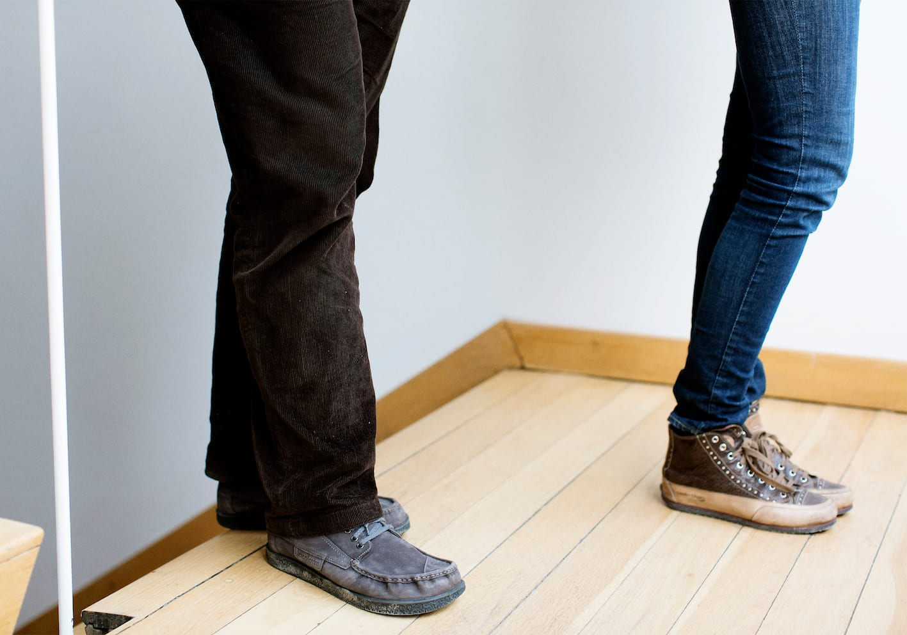
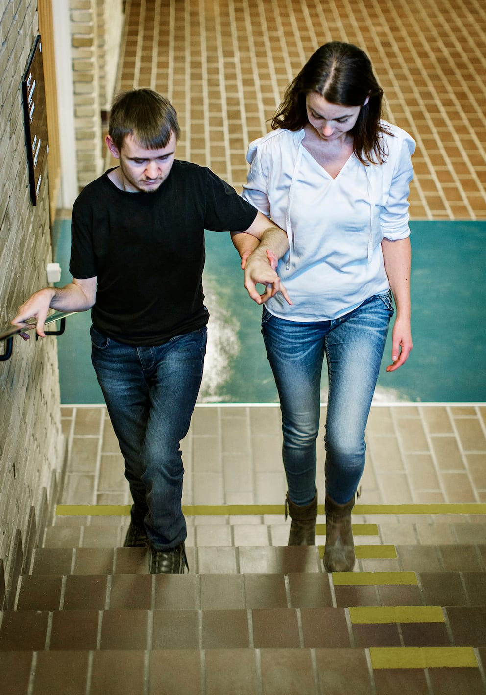
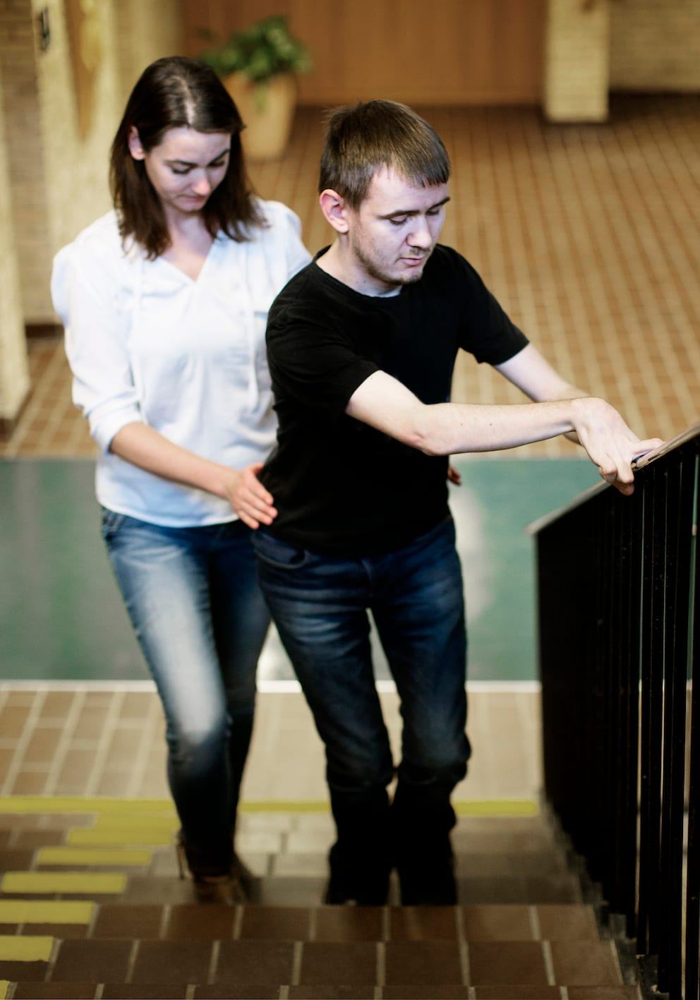

# Trapper

Når man kommer til en trappe, placerer ledsageren sig helt henne ved det første trin og fortæller Bo, om trappen går op eller ned.
Ledsageren skal først fortælle om trappen, når de er helt henne ved den.

Ledsageren kan vise Bo hvor gelænderet er ved at lægge sin ledsagehånd på gelænderet. Det kan være nødvendigt at skifte side for at komme over til gelænderet.

Ledsageren træder ned/op på det første trin og venter, til Bo er fremme ved trinet. Bo er stadig et skridt bag ledsageren.

Sammen går de op/ned ad trappen et trin forskudt.

Når Bo er færdig med trappetrinnene stopper ledsageren op.

Hvis trinnenes bredde varierer (fx på en vindeltrappe), skal Bo gå i den side, hvor trinnene er bredest.

__Ledsageren stopper altså 3 gange:__

- Når ledsageren står ved starten af trappen.

- Når ledsageren er et trin oppe/nede, og Bo er nået hen til trappens start.

- Når ledsageren har set, at Bo er færdig med trappetrinnene.

Personer, der anvender stok, foretrækker ofte at blive ledsaget hen til trappen og selv gå op eller ned ad trappen uden hjælp fra ledsageren.

## Ekstra støtte

Hvis der er behov for ekstra støtte, kan ledsageren benytte det støttende greb. Marc og ledsageren viser her, hvordan de, med den metode, går på samme trin med samme fod forrest.

Eller ledsageren kan gå baglæns på trappen foran Marc, mens grebet bevares. Begge holder da fast i gelænderet.

Særligt ængstelige personer kan vælge at gå baglæns ned ad trappen med støtte af gelænderet, mens ledsageren står nederst på trappen som sikkerhed. Her giver ledsageren ekstra støtte omkring Marcs hofter.

