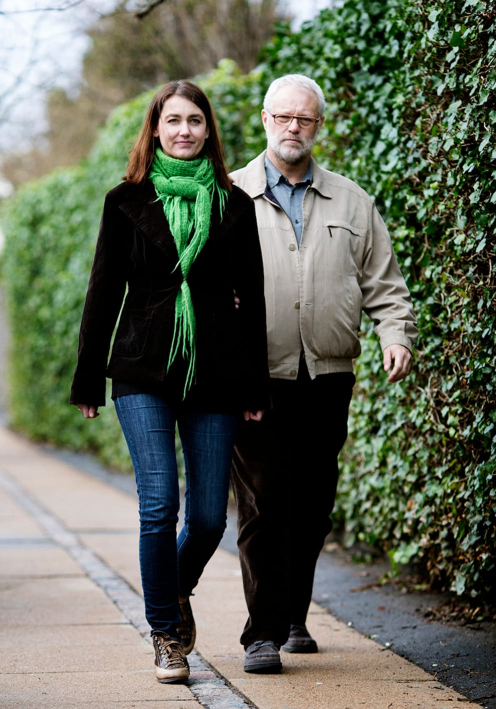

# Udendørs

Når man følges ad på et fortov, er det vigtigt at tænke over, hvordan man placerer sig på fortovet. Billedet her viser, hvordan ledsageren lader Bo gå midt på fortovets ene flise.

Hvis ledsageren selv går midt på flisen, vil Bo komme til at gå ovenpå rækken af chaussésten i midten, hvilket kan være utrygt og ubehageligt.

Hvis det er et befærdet sted med mange andre fodgængere, kan det være rarest for Bo at gå på den side af ledsageren, der vender væk fra de modgående.

Nogle vil også foretrække at gå på siden væk fra støjende trafik eller fx udstillede genstande på et butiksstrøg.

Alle betydelige niveauændringer, fx kantsten og større huller, behandles som ved trapper. Dvs. at ledsageren stopper 3 gange; når ledsageren kommer til kanten, når personen med blindhed er kommet hen til kanten, og når personen har passeret niveauændringen.

Hvis personen med blindhed er meget højere end ledsageren, skal ledsageren være særligt opmærksom på forhindringer i hovedhøjde for at sikre, at vedkommende ikke rammer fx baldakiner, grene eller sidespejle på lastbiler.
