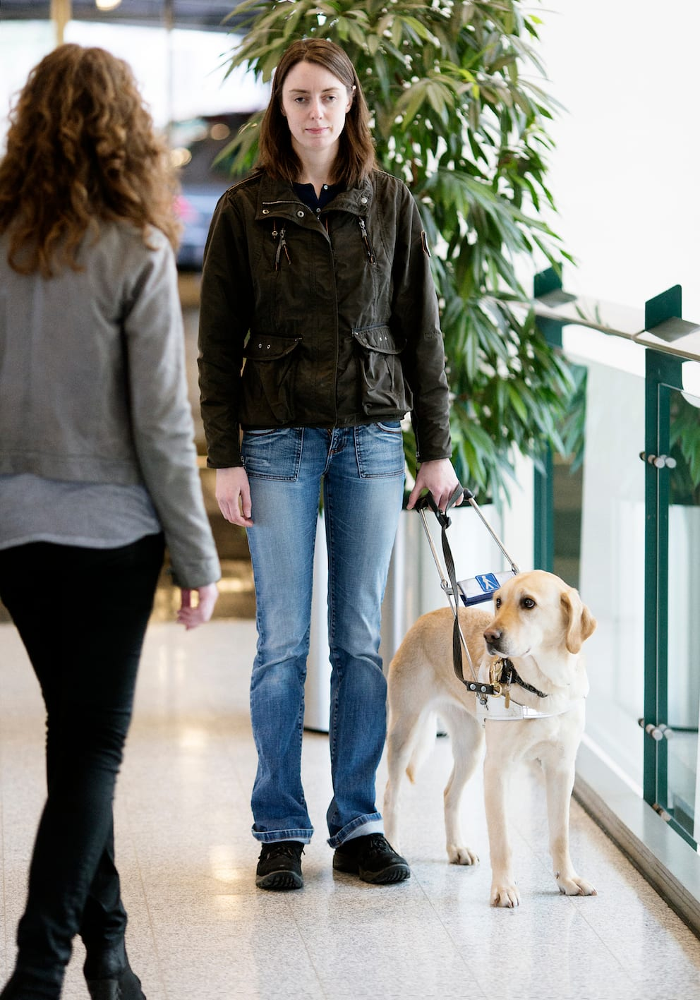
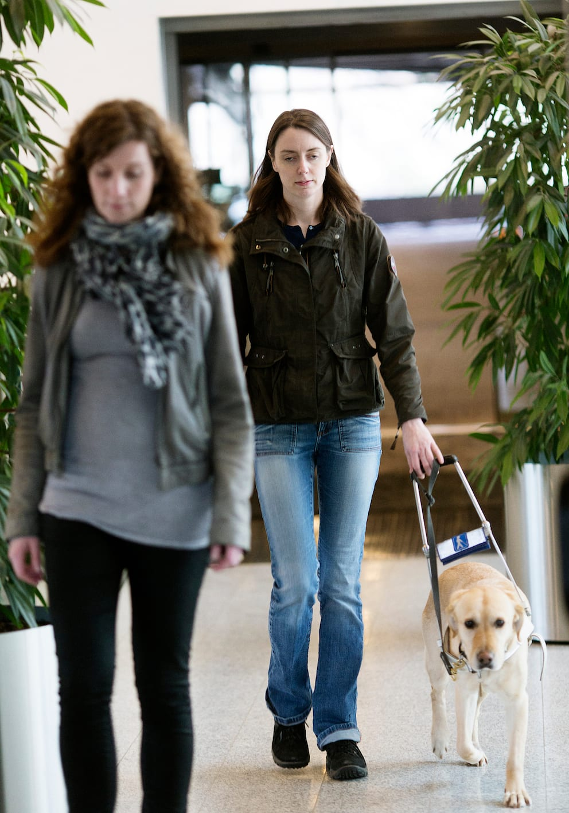
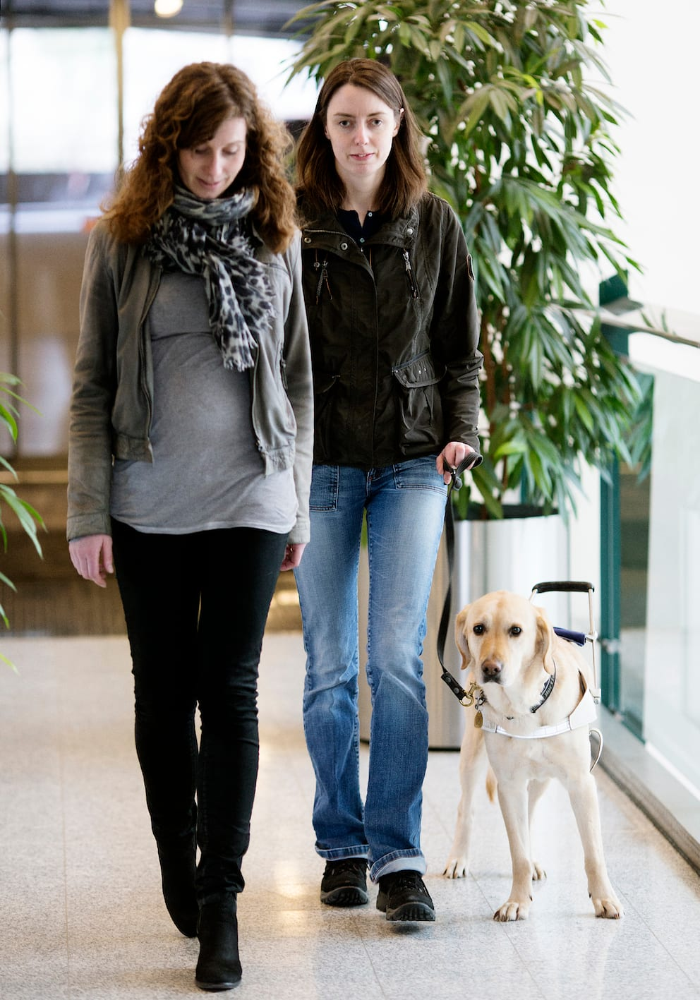

# Førerhund

Hvis man, som Lykke, anvender førerhund, skal ledsageren nærme sig fra den side, der er modsat hunden. Ledsageren må ikke gribe fat i bøjlen eller snoren, da Lykke skal være den, der har kontrollen over hunden.

Ledsageren går altid på siden modsat hunden. Nogle førerhundebrugere foretrækker at gå ved siden af ledsageren uden at holde fast i dennes arm og bruge hunden.

I visse situationer kan ledsageren også gå foran, således at hunden vil følge efter.

Hvis man ønsker at gribe fat i ledsagerens arm, må man, som Lykke her, slippe hundens bøjle, og kun føre den i snor, da hunden så ikke har ansvaret.

Det er altid personen med blindhed, der giver anvisninger til hunden, da det skal være helt klart for hunden, hvem der har kommandoen.

Går man på steder, der strider imod, hvad hunden har lært (fx på skrå eller på selve gaden), skal bøjlen også slippes og hunden føres i snor. Så ved hunden, at den ikke har ansvaret.
